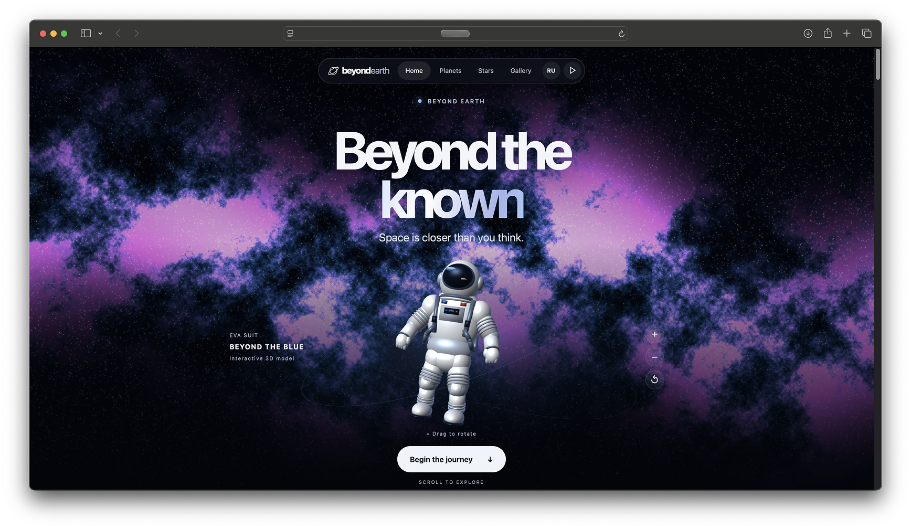
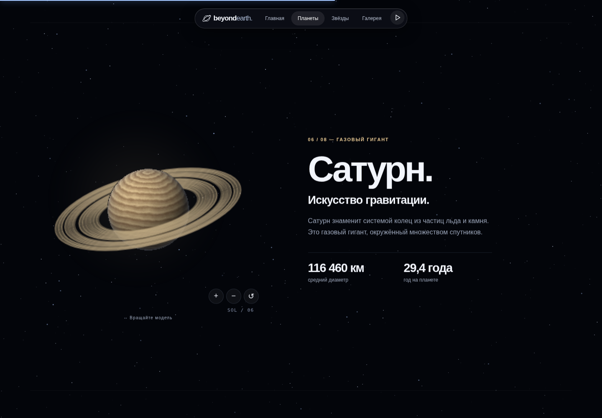
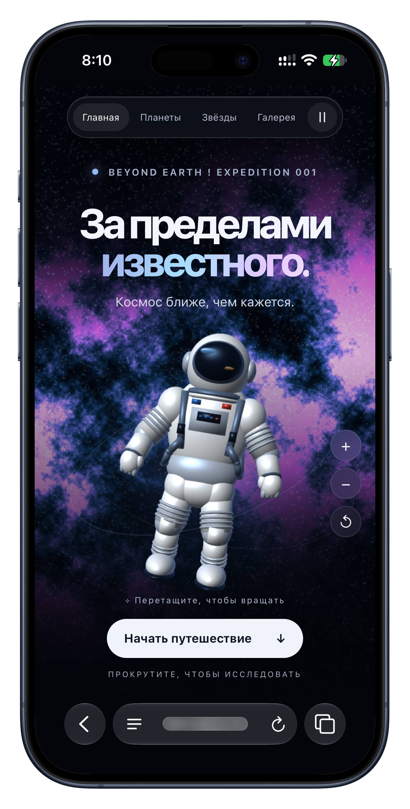

# Beyond Earth

An interactive journey through the Solar System. Explore planets, discover how stars evolve, and experience space through 3D models and cinematic web animations.



## About

Beyond Earth started as a college web development project and grew into an experiment in interactive storytelling, 3D graphics and interface design. The website is presented in Russian and is designed for both desktop and mobile browsers.

## Features

- Interactive astronaut, eight planets and the Sun, with 10 included GLB models.
- Mouse, touch and keyboard controls for exploring the models.
- Smooth scrolling, animated section transitions and a sliding navigation indicator.
- Animated statistics that count up when first scrolled into view.
- 4K (3840 × 2160) artistic space illustrations and a gallery with playback controls.
- Responsive layout, reduced-motion support and a pause button for animations.
- WebGL rendering with a Canvas-based fallback for unsupported devices.



## Built with

HTML · CSS · Vanilla JavaScript · WebGL · Canvas 2D · glTF/GLB

No frameworks, build step, npm dependencies or API keys are required.

## Run locally

Clone or download this repository. Open the project folder in VS Code and launch `index.html` using Live Server.

Alternatively, start a local HTTP server from the project root:

```bash
python -m http.server 8000
```

On macOS or Linux, use `python3` if required. Open <http://localhost:8000> in a browser with WebGL support. Opening the HTML file directly from disk may activate the fallback instead of real 3D rendering.

## Project structure

```text
BeyondEarth/
├── index.html
├── style.css
├── script.js
├── models.js
├── assets/
│   ├── images/
│   └── models/
├── screenshots/
└── README.md
```

## Mobile preview

<p align="center">
  
</p>

## Notes and credits

The astronaut, planet textures and space illustrations are stylized project assets, not NASA photographs. Planetary scales and textures are illustrative rather than scientifically exact. The fallback is a visual approximation, not full 3D. Screenshots are from the earlier 2.0 build; the current release also includes the navigation and counter animation updates.

Astronomy references: [NASA — Planets](https://science.nasa.gov/solar-system/planets/), [Solar System Facts](https://science.nasa.gov/solar-system/solar-system-facts/), [Sun Facts](https://science.nasa.gov/sun/facts/). Earth coastline outlines are based on [Natural Earth](https://www.naturalearthdata.com/about/terms-of-use/) (public domain). The project was developed with AI assistance.

## Project owner

[Gxmrr](https://github.com/Gxmrr) ! 2026
